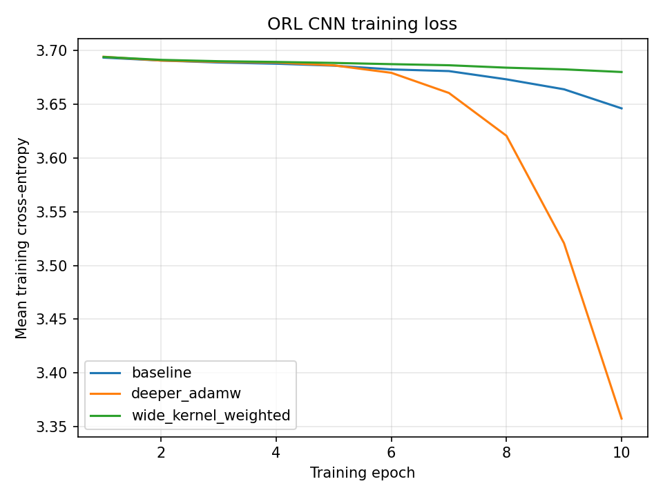

# Stage 3: CNN Image Classification

## Task and data

This stage trains convolutional neural networks to classify handwritten
digits (MNIST), faces (ORL), and colored objects (CIFAR-10). The supplied
instructor train/test splits were used without modification.

| Dataset | Training images | Testing images | Classes | Image dimensions |
|---|---:|---:|---:|---|
| MNIST | 60,000 | 10,000 | 10 | 1 x 28 x 28 |
| ORL | 360 | 40 | 40 | 3 x 112 x 92 |
| CIFAR-10 | 50,000 | 10,000 | 10 | 3 x 32 x 32 |

ORL images have three identical grayscale channels, as described in the
instructor dataset documentation. The provided pickle records contain the
images, integer labels, and train/test split for each dataset.

## Model and training

Each experiment uses convolution, ReLU, and 2 x 2 max pooling after each
convolution, followed by adaptive global average pooling and a fully connected
hidden/output classifier. The output layer emits one logit per class and is
trained with cross-entropy loss (class-weighted for the weighted experiment).
Convolutions use stride 1 and padding equal to half the kernel size.

| Experiment | Convolution channels | Kernel / padding / stride | Pooling | Hidden units | Optimizer | Loss |
|---|---|---|---|---:|---|---|
| baseline | 32, 64 | 3 / 1 / 1 | 2 x 2 max | 128 | Adam, 0.001 | Cross-entropy |
| deeper_adamw | 32, 64, 128 | 3 / 1 / 1 | 2 x 2 max | 256 | AdamW, 0.001 | Cross-entropy |
| wide_kernel_weighted | 32, 64 | 5 / 2 / 1 | 2 x 2 max | 128 | AdamW, 0.0005 | Weighted cross-entropy |

All runs used 10 epochs, batch size 64, and seed 42. Training ran on CPU.
Training loss decreased for every experiment. On MNIST and CIFAR, the deeper
model had the steepest loss reduction and lowest final training loss. ORL loss
decreased only slightly for the baseline and wide-kernel models; the deeper
model's training loss fell more noticeably late in training, but its test
accuracy remained very low.

## Test-set results

Metrics below are computed on the supplied held-out test splits. Values are
rounded to four decimal places; source CSVs are in `results/cnn/<dataset>/metrics/`.

| Dataset | Experiment | Accuracy | Weighted F1 | Macro F1 | Weighted Precision | Weighted Recall | Macro Precision | Macro Recall |
|---|---|---:|---:|---:|---:|---:|---:|---:|
| MNIST | baseline | 0.9520 | 0.9520 | 0.9514 | 0.9529 | 0.9520 | 0.9519 | 0.9517 |
| MNIST | deeper_adamw | 0.9875 | 0.9875 | 0.9874 | 0.9877 | 0.9875 | 0.9876 | 0.9874 |
| MNIST | wide_kernel_weighted | 0.9661 | 0.9661 | 0.9656 | 0.9668 | 0.9661 | 0.9658 | 0.9662 |
| ORL | baseline | 0.0250 | 0.0016 | 0.0016 | 0.0008 | 0.0250 | 0.0008 | 0.0250 |
| ORL | deeper_adamw | 0.0500 | 0.0095 | 0.0095 | 0.0053 | 0.0500 | 0.0053 | 0.0500 |
| ORL | wide_kernel_weighted | 0.0250 | 0.0013 | 0.0013 | 0.0007 | 0.0250 | 0.0007 | 0.0250 |
| CIFAR-10 | baseline | 0.5461 | 0.5383 | 0.5383 | 0.5461 | 0.5461 | 0.5461 | 0.5461 |
| CIFAR-10 | deeper_adamw | 0.6668 | 0.6587 | 0.6587 | 0.6989 | 0.6668 | 0.6989 | 0.6668 |
| CIFAR-10 | wide_kernel_weighted | 0.5223 | 0.5167 | 0.5167 | 0.5387 | 0.5223 | 0.5387 | 0.5223 |

ORL performance is poor: with 40 classes, chance-level accuracy is 0.025, and
the best run classified only 2 of the 40 test images correctly. Because the
test split contains just one image per subject, a single prediction changes
accuracy by 0.025. These results do not demonstrate reliable face recognition;
the ORL experiment needs further investigation, such as training longer and
testing a classifier that preserves more spatial information instead of using
global average pooling.

## Configuration impact

These are combined comparisons: the experiments change multiple settings at
once, so the results do not isolate the effect of any one setting. Changes
below are relative to the baseline and are in percentage points (pp).

| Dataset | Comparison | Accuracy change | Macro F1 change | Observation |
|---|---|---:|---:|---|
| MNIST | deeper_adamw vs baseline | +3.55 pp | +3.61 pp | The additional convolution block, wider hidden layer, and AdamW combination performed best. |
| MNIST | wide_kernel_weighted vs baseline | +1.41 pp | +1.43 pp | The combined larger-kernel, lower-learning-rate, AdamW, and weighted-loss setup improved modestly. |
| ORL | deeper_adamw vs baseline | +2.50 pp | +0.80 pp | Accuracy rose from 1/40 to 2/40 correct, but remains too low to support useful face recognition. |
| ORL | wide_kernel_weighted vs baseline | 0.00 pp | -0.03 pp | The changes did not improve the test result. |
| CIFAR-10 | deeper_adamw vs baseline | +12.07 pp | +12.04 pp | The deeper configuration produced the strongest improvement and lowest training loss. |
| CIFAR-10 | wide_kernel_weighted vs baseline | -2.38 pp | -2.16 pp | This combined configuration performed worse than baseline. |

The deeper configuration was best on MNIST and CIFAR-10, where its additional
capacity was accompanied by lower training loss and stronger test metrics.
The wide-kernel weighted configuration did not consistently help, and its
effects cannot be attributed to the kernel or weighted loss alone because the
optimizer and learning rate changed as well. ORL remains the main limitation:
the small training set, 40-way classification task, short 10-epoch schedule,
and global-average-pooling architecture are plausible contributors, but these
runs do not establish which factor is responsible.
