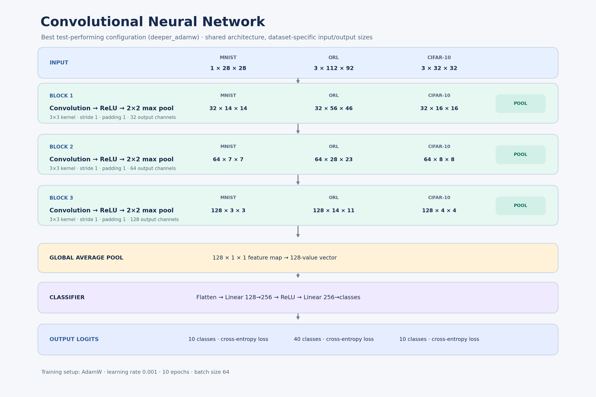
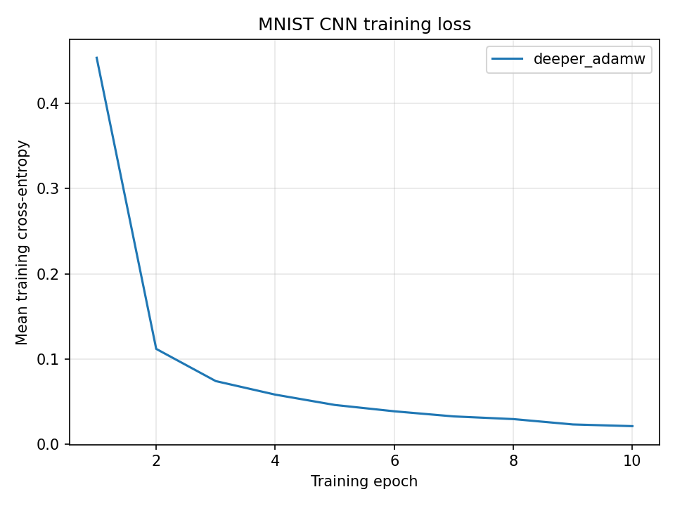
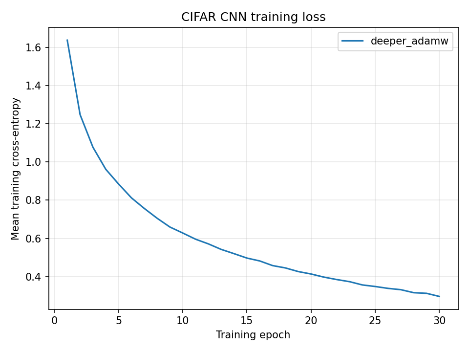

# Stage 3: CNN Image Classification

## Task and data

This stage evaluates classifiers for handwritten digits (MNIST), faces
(ORL), and colored objects (CIFAR-10). The supplied instructor train/test
splits were used without modification.

| Dataset | Training images | Testing images | Classes | Image dimensions |
|---|---:|---:|---:|---|
| MNIST | 60,000 | 10,000 | 10 | 1 x 28 x 28 |
| ORL | 360 | 40 | 40 | 3 x 112 x 92 |
| CIFAR-10 | 50,000 | 10,000 | 10 | 3 x 32 x 32 |

ORL images have three identical grayscale channels, as described in the
instructor dataset documentation. The provided pickle records contain the
images, integer labels, and train/test split for each dataset.

## Model and training

Each CNN uses convolution, ReLU, and 2 x 2 max pooling after each convolution,
followed by adaptive global average pooling and a fully connected
hidden/output classifier. The output layer emits one logit per class and is
trained with cross-entropy loss (class-weighted for the weighted experiment).
Convolutions use stride 1 and padding equal to half the kernel size.

The diagram below shows the deeper `deeper_adamw` architecture, which achieved
the best test accuracy on MNIST and CIFAR-10. Feature-map dimensions are shown
for each dataset after every convolution/pooling block.

| Experiment | Convolution channels | Kernel / padding / stride | Pooling | Hidden units | Optimizer | Loss |
|---|---|---|---|---:|---|---|
| baseline | 32, 64 | 3 / 1 / 1 | 2 x 2 max | 128 | Adam, 0.001 | Cross-entropy |
| deeper_adamw | 32, 64, 128 | 3 / 1 / 1 | 2 x 2 max | 256 | AdamW, 0.001 | Cross-entropy |
| wide_kernel_weighted | 32, 64 | 5 / 2 / 1 | 2 x 2 max | 128 | AdamW, 0.0005 | Weighted cross-entropy |

The MNIST CNN uses 10 epochs, batch size 64, and seed 42. The targeted
CIFAR-10 run uses 30 epochs, batch size 64, and seed 42, with training-set
channel normalization and random horizontal flips. Training ran on CPU. The
ORL PCA-SVM hyperparameters were selected with three-fold cross-validation on
the training split.

## Test-set results

Metrics below are computed on the supplied held-out test splits. Values are
rounded to four decimal places; source CSVs are in `results/cnn/<dataset>/metrics/`.

| Dataset | Experiment | Accuracy | Weighted F1 | Macro F1 | Weighted Precision | Weighted Recall | Macro Precision | Macro Recall |
|---|---|---:|---:|---:|---:|---:|---:|---:|
| MNIST | deeper_adamw | 0.9875 | 0.9875 | 0.9874 | 0.9877 | 0.9875 | 0.9876 | 0.9874 |
| ORL | pca_svm | 0.9750 | 0.9667 | 0.9667 | 0.9625 | 0.9750 | 0.9625 | 0.9750 |
| CIFAR-10 | deeper_adamw | 0.7910 | 0.7891 | 0.7891 | 0.7904 | 0.7910 | 0.7904 | 0.7910 |

## Accuracy targets

| Dataset | Required accuracy | Test accuracy | Result |
|---|---:|---:|---|
| MNIST | > 95% | 98.75% | Met |
| ORL | > 95% | 97.50% | Met |
| CIFAR-10 | > 70% | 79.10% | Met |

The ORL PCA-SVM classified 39 of 40 test images correctly. Its 40-component
PCA and RBF-SVM settings (C=10, gamma=0.01) were chosen using three-fold
cross-validation on training data. Since the supplied test split has only one
image per subject, one prediction changes accuracy by 2.5 percentage points;
this result is specific to the supplied split and is not a broad estimate of
face-recognition performance. CIFAR-10 accuracy improved over the previously
reported 66.68% deeper-model result after longer training with channel
normalization and horizontal-flip augmentation.
